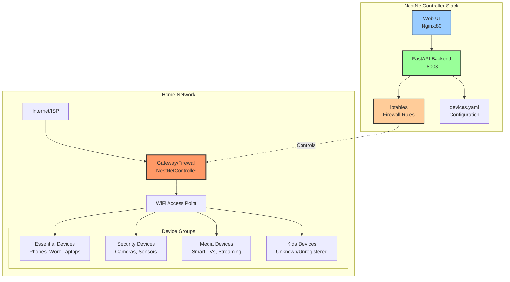
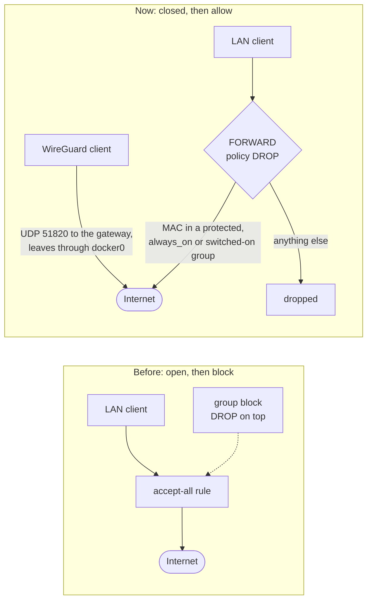

# NestNetController 🏠

> Family-friendly network firewall manager with device grouping and web UI

[](https://opensource.org/licenses/MIT)
[](https://www.docker.com/)
[](CONTRIBUTING.md)

**NestNetController** is a lightweight, Docker-based network firewall manager designed for families. It provides a simple web interface to control internet access for different device groups in your home network, with built-in safety features and dry-run testing mode.

---

## ✨ Features

- 🎛️ **Breaker-panel UI** - A lever per group, light and dark themes, works with no internet (see [DESIGN.md](DESIGN.md))
- 🎯 **Device Grouping** - Organize devices by MAC address into logical groups (Essential, Security, Media, Kids)
- 🔒 **Easy Control** - Simple web UI to enable/disable internet access per group
- ⚡ **Scenes** - One-click presets like "Essential and cameras" for bedtime or focused work
- 🧪 **Safe Testing** - Dry-run mode to test without affecting your network
- 📊 **Activity Logs** - Track who blocked/unblocked what and when
- 🐳 **Docker Ready** - Simple deployment with docker-compose
- 🚫 **Deny by default** - Nothing reaches the internet unless its group is protected, always on, or switched on in the UI; **WireGuard is the way in for everything else** (see [Architecture change](#-architecture-change-deny-by-default-and-wireguard))
- 🔐 **Protected Groups** - Infrastructure devices (routers, switches) are never blocked
- 🛡️ **Guaranteed Panel Access** - The control panel stays reachable from your LAN (and via WireGuard) no matter what gets blocked

---

## 🏗️ Architecture



**How it works:**
1. Gateway runs NestNetController with Docker
2. FastAPI backend manages iptables firewall rules
3. Web UI provides simple control interface
4. Device groups defined by MAC address in YAML config
5. **Default-deny model:** everything is blocked unless it is on the allowlist. A device is allowed when its group is `protected` (infrastructure), `always_on` (cameras, your own computers) or switched on in the UI. On every app startup (and every "Reload Config" or switch) the backend syncs one ACCEPT rule per allowed MAC, sets the `FORWARD` policy to DROP and deletes the broad "LAN to internet accept all" rule, so listed-but-off groups and unknown devices are cut with no separate action needed
6. `protected` and `always_on` groups have no switch: the panel and the API refuse (HTTP 403) to turn them off, and scenes skip them, so the cameras and your essential devices cannot be cut by a tap or a request. The only way out is to remove a device from the list on purpose
7. A separate host-level failsafe rule guarantees the control panel itself is always reachable, independent of any group/device blocking or the allowlist sync (see [Guaranteed Panel Access](#-guaranteed-panel-access-failsafe) below)

---

## 🔀 Architecture change: deny by default, and WireGuard

Up to v1.0 the gateway worked the other way round: every LAN client had internet through one broad "LAN to internet, accept" rule, and the app only blocked groups on top of it. **Now the network is closed by default.** A device gets internet only if someone decided so.



| Question | Before | Now |
|---|---|---|
| New or unknown device | has internet | has none |
| Family phones, TVs, Echo | always on, blockable | off until the group is switched on in the UI (unless you mark the group `always_on`) |
| Cameras, essential devices, your own computers | like everyone | always on (`always_on`), no switch, cannot be turned off |
| Infrastructure | protected | protected |
| What does "switch a group off" do | add DROP rules | take it off the allowlist; locked groups (`protected`, `always_on`) refuse |
| The accept-all rule | present, never removed (it lived in `DOCKER-USER`, the app looked in `FORWARD` on the wrong interface) | removed by the app on every sync, last, after the allow rules and the DROP policy are in place |
| State of switchable groups | none | `config/group_state.json`, survives restarts, unreadable means everything off |

### You have to use WireGuard

Phones are the problem: Android rotates the MAC address per network, so a phone is never reliably "listed", and a phone that is not allowed has no internet on your own Wi-Fi. The way around it is the tunnel:

- **Your phones and laptops connect through WireGuard** (also at home). The tunnel is authenticated by its key, not by a MAC, and its traffic is allowed explicitly: the packets reach the gateway on UDP 51820 (the gateway's own traffic, not forwarded), and what leaves for the internet goes out through the WireGuard container's bridge, which `ALLOW_INTERFACES=docker0` accepts. Tested on a phone on 2026-10-12: on the house Wi-Fi it had no internet without WireGuard and had it with WireGuard on, with mobile data off.
- **Anything that cannot run WireGuard** (cameras, TVs, Echo, printers) is listed by MAC in a group, because its MAC does not change.
- **Every WireGuard key is a way to the internet through your house**, whatever its MAC. Revoke keys you no longer use in the WireGuard panel.
- If your phone loses its internet by accident, turn on WireGuard (or mobile data and then WireGuard), open the panel and switch its group on or add the new MAC.

If your gateway runs WireGuard on the host instead of in a container, put its interface (`wg0`) in `ALLOW_INTERFACES`, because it appears directly as a network interface of the host.

### Upgrading an existing gateway

1. Pull the new code. Copy nothing else: `devices.yaml` is yours.
2. Add `always_on: true` to the groups that must keep internet without being switched on (cameras, your computers), or the new code will cut them like any other group. `protected` groups need nothing.
3. Add `ALLOW_INTERFACES=docker0` (or your WireGuard interface) to `.env`. If the file does not end with a newline, add one first: appending to the last line breaks the file.
4. Rebuild: `docker compose up -d --build nestnet-backend`. The sync removes the accept-all rule itself.
5. Test with a roll back ready: stop the container and put the accept-all rule back if you are cut off (see [Locked yourself out](#locked-yourself-out)).
6. When you are happy, save the rules so a reboot comes back closed: `sudo netfilter-persistent save`. Otherwise `/etc/iptables/rules.v4` brings the accept-all rule back until the container starts.

---

## 🚀 Quick Start

### Prerequisites

- Linux system (Debian, Ubuntu, or similar)
- Docker and Docker Compose
- Root/sudo access for firewall management
- Gateway/router running Linux

### Installation

1. **Clone the repository:**
```bash
git clone https://github.com/zekefarioli-arch/NestNetController.git
cd NestNetController
```

2. **Configure environment:**
```bash
cp .env.example .env
nano .env
```

Edit `.env` with your network settings:
```env
WAN_INTERFACE=eth0      # Your internet-facing interface
LAN_INTERFACE=eth1      # Your local network interface
DRY_RUN=true           # Keep true for testing!
ADMIN_USERNAME=admin
ADMIN_PASSWORD=ChangeThisPassword123
JWT_SECRET=generate-a-long-random-secret-here
```

> ⚠️ **Double-check `WAN_INTERFACE` against reality**, not just `ip addr show`. On multi-NIC gateways it's easy to have a stale or unused interface (e.g. a disabled `eth1`) while the actual LAN traffic flows over a different one (e.g. `enp7s0f0`). Confirm with `ip -brief link show` and `iptables -L FORWARD -v -n` (see [Network Interfaces](#network-interfaces)) before trusting the `.env` defaults — `firewall.py` only reads `WAN_INTERFACE` for blocking, so getting that one right matters most.

3. **Configure devices:**
```bash
nano config/devices.yaml
```

Add your actual devices with real MAC addresses:
```yaml
groups:
  essential:
    description: "Critical devices that should always have internet"
    devices:
      - name: "dad_phone"
        mac: "AA:BB:CC:DD:EE:01"
        description: "Dad's work phone"
      - name: "mom_laptop"
        mac: "AA:BB:CC:DD:EE:02"
        description: "Mom's laptop"
  
  security:
    description: "Security cameras and monitoring devices"
    devices:
      - name: "front_camera"
        mac: "AA:BB:CC:DD:EE:03"
        description: "Front door camera"
  
  media:
    description: "Entertainment devices"
    devices:
      - name: "living_tv"
        mac: "AA:BB:CC:DD:EE:04"
        description: "Living room Smart TV"
  
  infrastructure:
    description: "Network infrastructure - NEVER BLOCKED"
    protected: true
    devices:
      - name: "gateway_lan"
        mac: "AA:BB:CC:DD:EE:F1"
        description: "Gateway LAN interface"
      - name: "main_router"
        mac: "AA:BB:CC:DD:EE:F2"
        description: "Main WiFi router/AP"
```

> ⚠️ **YAML indentation matters here.** Every key under a group (`description`, `protected`, `devices`) must be indented *inside* that group, not aligned with the group name itself. A misindented `infrastructure:` or `kids:` block silently breaks that group — it either loads as `null` or gets hoisted to the wrong level in `groups`. After editing, always verify with:
> ```bash
> docker exec nestnet-api python3 -c "from app.services.device_service import device_service; print(device_service.load_groups())"
> ```
> and confirm each group (especially `infrastructure`) shows the devices and `protected` value you expect.

**Finding MAC addresses:**
```bash
# On the gateway, see all connected devices:
sudo arp -a

# Or check network neighbors:
ip neigh show
```

4. **Start in dry-run mode (safe testing):**
```bash
docker compose up -d
```

5. **Access the web UI:**

Open in your browser: `http://YOUR_GATEWAY_IP:3002`

Default login: `admin` / `ChangeThisPassword123`

> 🛡️ This URL is designed to stay reachable even if a scene turns every device group off, thanks to the host-level failsafe rule below — but only once you've set it up. New installs should configure it before going to production (step below).

---

## 🛡️ Guaranteed Panel Access (Failsafe)

The whole point of this tool is to be able to cut a device's internet access — which means the one thing that must **never** get cut by accident is your own access to the panel that controls it. This is handled at two levels:

### Level 1: App-level design (already built in)

`firewall.py` only ever writes rules to the `FORWARD` chain, scoped to `-o $WAN_INTERFACE` (i.e. "traffic leaving towards the internet"). It never touches `INPUT`. This means device blocking only affects a device's *outbound internet access* — it was never capable of blocking access to the gateway's own local services (like the panel) in the first place. No configuration needed for this part.

### Level 2: Host-level failsafe rule (recommended, one-time setup)

Depending on how your reverse proxy/UI container is networked, panel traffic can also pass through Docker's own `FORWARD`-adjacent chains (`DOCKER`, `DOCKER-USER`) rather than plain `INPUT` — for example when the UI container is port-mapped instead of using `network_mode: host`. To guarantee access regardless of network topology changes (new switches, new NICs, VPN interfaces), add one rule directly on the **host**, in Docker's `DOCKER-USER` chain — the only chain Docker guarantees it will never rewrite automatically:

```bash
sudo iptables -I DOCKER-USER 1 ! -i $WAN_INTERFACE -p tcp --dport 3002 -j ACCEPT
```

Replace `$WAN_INTERFACE` with your actual WAN interface (e.g. `ppp0`). This rule reads: *"any traffic to the panel port that does NOT come from the WAN, gets accepted"* — regardless of which LAN interface, switch, or bridge it arrives on. That includes:
- Any current or future LAN interface/switch
- Docker bridge networks
- A WireGuard tunnel (`wg0` or a WireGuard container's bridge) when connecting remotely — no need to name it explicitly, since it's simply "not the WAN"

**Make it persistent** so it survives a gateway reboot:
```bash
sudo apt install iptables-persistent   # if not already installed
sudo netfilter-persistent save
```

**Verify it's active and first in line:**
```bash
sudo iptables -L DOCKER-USER -v -n --line-numbers
```

**Test from another device on the LAN:**
```bash
curl -I http://YOUR_GATEWAY_IP:3002
# Expect: HTTP/1.1 200 OK
```

This rule is intentionally set up **outside of Docker and outside this repo** (directly on the host, saved via `netfilter-persistent`) so it keeps working even if Docker itself fails to start, the compose stack breaks, or a future bug gets introduced in `firewall.py`. Authentication (username/password + JWT) remains the only real gate on *who* can act once they reach the panel — this rule only guarantees *reachability*.

---

## 📖 Usage

### Web Interface

The dashboard shows:
- **Scenes** - One-click presets for common scenarios
- **Breakers** - A lever for each group
- **Activity Log** - History of all actions

### Scenes

Presets that change several groups at once:

- **Essential and cameras** - Turns every other switchable group off (great for bedtime); locked groups stay on
- **Everything on** - Turns every switchable group on
- **Reload devices** - Re-reads `devices.yaml` (a small button above the breakers)

### Managing Groups

The panel opens with a sentence built from the live state ("Media and Essential are off. 6 devices cannot reach the internet, 15 can."). Each switchable group is a row with a **lever**: on means its devices have internet, off means they have none; the words "Internet on" or "Internet off" say it too. Groups that are protected are listed under "Always on" with a lock and no lever. Tap "N devices" to see the names. The activity list below shows who changed what and when.

The panel renders with no internet access: its CSS, fonts and icons are served by the panel itself (`frontend/static`), so you can still use it from a device that has just been cut off. The design rules are in [DESIGN.md](DESIGN.md).

### Dry-Run Mode

**IMPORTANT:** Always test in dry-run mode first!

When `DRY_RUN=true`, the system:
- ✅ Shows what iptables commands it would run
- ✅ Logs all actions
- ❌ Does NOT actually modify firewall rules

Check logs to verify behavior:
```bash
docker logs nestnet-api
```

You should see:
```
[DRY-RUN] Blocking device dad_phone (AA:BB:CC:DD:EE:01)
[DRY-RUN] Unblocking device mom_laptop (AA:BB:CC:DD:EE:02)
```

### Going to Production

When ready to use for real:

1. **Set up the panel-access failsafe first** (see [Guaranteed Panel Access](#-guaranteed-panel-access-failsafe)) — do this *before* flipping dry-run off, so you're never testing real blocking without a safety net already in place.

2. **Set dry-run to false:**
```bash
nano .env
# Change: DRY_RUN=false
```

3. **Restart containers:**
```bash
docker compose down
docker compose up -d
```

4. **Test carefully:**
   - Start with a non-critical device
   - Block it and verify connectivity is cut
   - Unblock and verify connectivity restores
   - From another device (and, if possible, over WireGuard from outside), confirm the panel itself is still reachable
   - Check logs for any errors

---

## 🔧 Configuration

### Network Interfaces

**Finding your interfaces:**
```bash
ip addr show
ip route | grep default
```

**Confirm which interface is actually carrying traffic** (don't rely on `.env` defaults alone):
```bash
ip -brief link show
sudo iptables -L FORWARD -v -n --line-numbers
```
Look for the interface with non-zero packet counters in `FORWARD` — that's your real LAN interface, even if a different one is configured or wired up.

Common setups:
- **Router/Gateway:** WAN=`eth0`, LAN=`eth1`
- **PPPoE Connection:** WAN=`ppp0`, LAN=`eth0`
- **USB Network:** May show as `enx...` or similar
- **Multi-NIC gateway:** may have unused/disabled interfaces present (`DOWN` in `ip -brief link show`) alongside the active one — always verify with the commands above rather than assuming

### Default-Deny Model (Allowlist)

**By default the network is closed.** Only these reach the internet:

| Who | How it is decided |
|---|---|
| Infrastructure (router, access point, media server) | group with `protected: true`, never blockable |
| Cameras, your own computers | group with `always_on: true`; they work without being switched on and **cannot be switched off** from the panel or the API (403) |
| WireGuard clients | the interfaces in `ALLOW_INTERFACES` (on the router `docker0`, where the WireGuard container's traffic arrives) |
| Any other group (family phones, TVs, Echo...) | only while the group is switched on in the UI; the switch is remembered in `config/group_state.json` and survives restarts |
| Anything not listed (a guest, a new gadget, a phone with a changed MAC) | never |

How it is enforced:

- On every backend startup, and every time a group is switched or "Reload Config" runs, `sync_allowlist()` makes the `FORWARD` chain match that table: it adds the missing ACCEPT rules (one per allowed MAC, tagged `nestnet-allow`, plus one per allowed interface, tagged `nestnet-allow-if`), removes stale ones, sets the policy to DROP, and **last** deletes any broad `-i <LAN> -o <WAN> -j ACCEPT` rule in `FORWARD` or Docker's `DOCKER-USER` chain, whatever LAN interface it names. That order means nobody is cut by the sync itself.
- Replies from the internet are accepted by an `ESTABLISHED,RELATED` rule on the WAN interface; the sync adds it if it is missing.
- Switching a group off only takes it off the allowlist. Locked groups (`protected`, `always_on`) cannot be switched off by the toggle, disable or scene endpoints; the backend answers 403 and the tests cover every route.
- An unreadable `group_state.json` fails closed: no optional group is on.

**Practical implication:** a new device has no internet until its MAC is in a group that is on. After editing `devices.yaml`:

```bash
# After adding a device to devices.yaml:
curl -X POST -u admin:yourpassword http://localhost:8003/devices/reload
# or just click "Reload Config" in the web UI
```

> The broad accept-all rule is not saved anywhere by this app. If your gateway restores it at boot (`/etc/iptables/rules.v4`), the network is open from boot until the backend starts; run `netfilter-persistent save` once after the first sync so a reboot comes back closed.

### ⚠️ MAC Address Reliability — Not All Devices Behave the Same

This system identifies devices by MAC address, which works reliably for **fixed-function / "dumb" devices** but is fragile for modern smartphones due to **MAC randomization**.

**Confirmed reliable (static MAC, safe to manage by group):**
- Security cameras (Blink, Ring)
- Amazon Echo devices (Show, Dot)
- Desktops/laptops (wired and WiFi)
- Network infrastructure (routers, access points) — always `protected: true`, never touched anyway

**Unconfirmed / needs testing:**
- Smart TVs (LG, Google TV) — some smart TVs also randomize MAC on WiFi; wired connections are safe, WiFi is unverified on this network

**Known unreliable — Android phones:**
Modern Android versions use a **randomized MAC address per WiFi network** by default, and periodically rotate it even on the same network. The setting to disable this ("Use device MAC" instead of "Use randomized MAC") exists per-network in Android's WiFi settings, but:
- It's buried a few taps deep and easy to lose track of
- Some Android versions/OEM skins reset it after updates
- A phone that "worked" with a pinned MAC can silently start rotating again without any visible warning

**Practical consequence:** if you rely on group-blocking a phone by MAC (e.g. "Only Essential" at bedtime) and Android quietly rotates its MAC, that phone effectively becomes an unregistered device — it won't match any `nestnet-allow` rule and will lose internet entirely, appearing indistinguishable from a hardware/config problem.

**Current workaround: always keep a WireGuard connection available.** This isn't just for being away from home — it also recovers you when you're on your own WiFi and got cut off:

- **Why LAN access alone doesn't save you:** the MAC allowlist only gates outbound *internet* access (the `FORWARD` chain, matched against `nestnet-allow` rules). It never gates LAN access — any device on your home WiFi can always reach the panel locally. The problem is that once a phone's MAC gets blocked, that phone has **no internet at all, WiFi included** — so even though the panel is technically reachable on the LAN, the phone itself can't get there because it has no connectivity to route through.
- **Why WireGuard fixes it:** WireGuard isn't "a device on the LAN asking to go out" — it's a tunnel that places you *inside* the LAN, authenticated by the tunnel's own key rather than by MAC address. The tunnel itself is not matched by MAC; its traffic out to the internet is allowed through `ALLOW_INTERFACES` (see [Architecture change](#-architecture-change-deny-by-default-and-wireguard)).
- **At home, WiFi cut off by a MAC block:** switch that phone to mobile data, connect via WireGuard, and you're back inside the LAN with a working connection to the panel — from there you can re-enable the group or add the new MAC.
- **Away from home:** same thing — WireGuard over mobile data gets you in regardless of any group block currently active.

See [Guaranteed Panel Access](#-guaranteed-panel-access-failsafe) for the failsafe rule that keeps the panel itself always reachable via WireGuard — this section explains why you specifically need WireGuard (not just "any LAN device") to make use of that reachability once a phone loses its own connectivity.

### Device Groups

Groups are defined in `config/devices.yaml`. Each group has:
- **name** - Unique identifier (essential, security, media, infrastructure, kids)
- **description** - Human-readable description
- **devices** - List of devices with MAC addresses
- **protected** - If true, cannot be blocked (infrastructure only)
- **always_on** - If true, the group always reaches the internet (cameras, essential devices, workstations) and has no switch: the panel shows it under "Always on" and the API refuses to turn it off

**Special Groups:**
- **infrastructure** - Network equipment, always protected
- **kids** - Auto-populated with unknown devices (future feature)

> ⚠️ Both special groups are easy to misconfigure via YAML indentation — see the warning under [Installation, step 3](#installation) and always confirm with `device_service.load_groups()` after editing.

### Panel Access vs. Device Protection — two different things

It's worth being explicit about this, since they're easy to conflate:

| | **Protected devices** (`infrastructure` group) | **Panel access failsafe** (`DOCKER-USER` rule) |
|---|---|---|
| Purpose | Stops your router/AP/switches from losing **their own** internet access | Guarantees **any** device can always reach the control panel |
| Scope | Only devices explicitly listed by MAC | Universal — no device list needed |
| Where it lives | `config/devices.yaml` | Host iptables (`DOCKER-USER` chain), outside the app |
| What breaks it | Wrong/missing MAC in the list | N/A — doesn't depend on device identity at all |

You do **not** need to list every device that should be able to reach the panel. The failsafe rule works by excluding only the WAN interface, so it covers every LAN device, every future switch/NIC, and WireGuard connections automatically.

### Security Settings

**Users.** The first user is the admin of `.env` (`ADMIN_USERNAME` and `ADMIN_PASSWORD`, kept in plain text there). More users, and a better password for the admin, live hashed (scrypt) in `config/users.yaml`, managed inside the container. The password is asked for twice and never goes on the command line:

```bash
docker exec -it nestnet-api python -m app.users set vivi     # add a user or change a password
docker exec -it nestnet-api python -m app.users set admin    # the admin: from then on the file wins over .env
docker exec -it nestnet-api python -m app.users list
docker exec -it nestnet-api python -m app.users remove vivi
```

Passwords need at least 12 characters. Changing a password or removing a user ends that user's open sessions (the session token carries a fingerprint of the credential); changing `JWT_SECRET` ends everyone's. The activity log names the user who made each change.

**Change default credentials immediately:**
```bash
nano .env
# Update ADMIN_PASSWORD and JWT_SECRET
```
(or set the admin with `app.users` as above and leave `ADMIN_PASSWORD` as a long random value you do not use.)

**Use strong passwords:**
- At least 12 characters
- Mix of letters, numbers, symbols
- Avoid common words

**JWT Secret:**
```bash
# Generate a secure random secret:
openssl rand -hex 32
```

---

## 🛠️ Development

### Project Structure

```
NestNetController/
├── backend/              # FastAPI application
│   ├── app/
│   │   ├── models/       # Pydantic models
│   │   ├── services/     # Business logic
│   │   │   ├── firewall.py    # iptables management
│   │   │   ├── auth.py        # Authentication
│   │   │   └── device_service.py  # Device config
│   │   └── routers/      # API endpoints
│   ├── Dockerfile
│   └── requirements.txt
├── frontend/             # Static HTML/JS UI
│   ├── static/js/
│   ├── templates/
│   ├── Dockerfile
│   └── nginx.conf
├── config/               # Device configuration
│   └── devices.yaml
├── logs/                 # Activity logs
├── docker-compose.yml
└── README.md
```

### Running Locally

```bash
# Start with logs visible
docker compose up

# Rebuild after code changes
docker compose up --build

# Run in background
docker compose up -d

# View logs
docker logs nestnet-api
docker logs nestnet-ui

# Stop everything
docker compose down
```

### Adding Features

See [CONTRIBUTING.md](CONTRIBUTING.md) for development guidelines.

**Current tech stack:**
- **Backend:** Python 3.11, FastAPI, iptables
- **Frontend:** HTML, Tailwind CSS, Vanilla JavaScript
- **Infrastructure:** Docker, Nginx, Docker Compose

---

## 🐛 Troubleshooting

### Container won't start

**Check Docker is running:**
```bash
sudo systemctl status docker
sudo systemctl start docker
```

**Check logs:**
```bash
docker compose logs
```

### Backend keeps restarting

**Port conflict (8003 already in use):**
```bash
# Find what's using the port:
sudo lsof -i :8003

# Change the port in backend/Dockerfile:
CMD ["uvicorn", "app.main:app", "--host", "0.0.0.0", "--port", "8004"]
```

### Can't access UI

**Check the host-level failsafe rule is present and first in `DOCKER-USER`:**
```bash
sudo iptables -L DOCKER-USER -v -n --line-numbers
```
If it's missing, see [Guaranteed Panel Access](#-guaranteed-panel-access-failsafe) to add it back.

**Check firewall rules allow port 3002:**
```bash
sudo iptables -L INPUT -v -n | grep 3002
sudo iptables -L FORWARD -v -n | grep 3002
```

**Access from gateway itself:**
```bash
curl http://localhost:3002
```

### Rules not applying

**Verify dry-run mode is disabled:**
```bash
docker exec nestnet-api env | grep DRY_RUN
# Should show: DRY_RUN=false
```

**Check iptables rules:**
```bash
sudo iptables -L FORWARD -v -n
```

### Locked yourself out

If you've set up the [panel-access failsafe](#-guaranteed-panel-access-failsafe), this shouldn't happen — the panel stays reachable regardless of device/group blocking. If you still can't reach it:

**SSH into the gateway and open the network again** (stop the app so it does not close it again, then put the accept-all rule back; use your LAN and WAN interface names):
```bash
docker stop nestnet-api
sudo iptables -I DOCKER-USER 2 -i enp7s0f0 -o ppp0 -j ACCEPT
```
Do not flush `FORWARD`: it also holds Docker's jumps.

**Or from console:**
```bash
cd ~/projects/NestNetController
docker compose down
```

**If even that fails**, the `DOCKER-USER` failsafe rule (being independent of the compose stack and of `FORWARD`) should still let you reach the panel to diagnose from there — this is exactly the scenario it's designed for.

---

## 🗺️ Roadmap

### ✅ Completed (v1.0)
- [x] FastAPI backend with iptables integration
- [x] Web UI with login and authentication
- [x] Device group management
- [x] Quick actions
- [x] Activity logging
- [x] Dry-run testing mode
- [x] Docker containerization
- [x] Guaranteed, device-list-independent panel access (host-level failsafe)
- [x] Default-deny firewall model — only protected, always-on or switched-on groups get internet access; WireGuard is allowed by interface (tested on a real gateway, 2026-10-12)

### 🚧 In Progress
- [ ] Fix config volume mounting issue
- [x] Add dry-run mode badge to UI
- [ ] Improve error handling and user feedback
- [ ] Automate failsafe rule setup (install script instead of manual `iptables` command)
- [ ] Mobile app (React Native) — QR-based WireGuard onboarding via the official WireGuard app; the mobile app detects when the gateway isn't reachable and auto-triggers the `wireguard://` deep link to activate the already-saved tunnel, then retries. No WireGuard keys, configs, or QR codes are ever generated by, stored in, or committed to this repo — tunnel provisioning happens once, out-of-band, directly on the gateway (`wg genkey`/`qrencode`), completely outside the app's code path.

### 📋 Planned Features
- [ ] Auto-detection of unknown devices (kids group)
- [ ] Scheduling (automatic rules by time of day)
- [ ] Usage statistics and reporting
- [ ] Multi-user support with permissions
- [ ] Integration with Home Assistant
- [ ] Bandwidth throttling (QoS)
- [ ] Notifications (email, Slack, Discord)
- [ ] Backup and restore configuration
- [ ] API documentation (Swagger/OpenAPI)

---

## 🤝 Contributing

Contributions are welcome! Please read [CONTRIBUTING.md](CONTRIBUTING.md) for guidelines.

**Ways to contribute:**
- 🐛 Report bugs
- 💡 Suggest features
- 📖 Improve documentation
- 🔧 Submit pull requests
- ⭐ Star the repo if you find it useful!

---

## 📄 License

This project is licensed under the MIT License - see the [LICENSE](LICENSE) file for details.

---

## 🙏 Acknowledgments

- Built for families who want simple, safe network control
- Inspired by the need for parental controls without expensive hardware
- Thanks to the open-source community for the tools that made this possible

---

## 📞 Support

- **Issues:** [GitHub Issues](https://github.com/zekefarioli-arch/NestNetController/issues)
- **Discussions:** [GitHub Discussions](https://github.com/zekefarioli-arch/NestNetController/discussions)

---

## ⚠️ Disclaimer

This software is provided "as is" without warranty. Use at your own risk. Always test in dry-run mode before deploying to production. The authors are not responsible for any network disruptions or connectivity issues.

**Security Note:** This tool requires privileged access to modify firewall rules. Ensure proper authentication and keep your admin credentials secure. The panel-access failsafe rule guarantees *reachability*, not *authorization* — login credentials remain the only real access control. With the default-deny allowlist model active, an incomplete `devices.yaml` (missing MACs) will cut internet access for those devices — always verify new/changed hardware is added before relying on it.

---

Made with ❤️ for families who want better control of their home network.